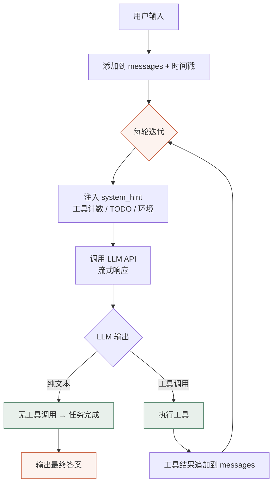

# Coding Agent 与代码生成

> **为什么"会写代码"是通用 Agent 的问题求解方式** —— 第 5 章学习笔记

`📅 2026-10-21 ~ 10-22` ｜ `🧪 跑通实验 2 个` ｜ `📝 自测题 5/5` ｜ `🔧 顺手修了 1 个真 bug`

**目录**：引言 · 实验一 · 实验二 · 排错复盘 · 自测题 · 总结

---

## 0. 引言：我原来的理解是错的

翻开这一章之前，我以为 Coding Agent 就是"会自动补全、能帮我写函数"的东西。学完发现差得很远：

> 💡 **能生成代码的助手是"开环"的，Coding Agent 是"闭环"的** —— 它把代码写进文件、跑一遍、看到真实输出、再决定下一步。代码只是媒介，**闭环**才是本体。

本章更大的主张：代码是 **"能创造新工具的工具"**。模型不需要预装专用工具去解决每类问题——用 Python + 通用库，现场把问题形式化、写成程序、交给确定性的执行环境算出答案。

---

## 1. 实验一：code-for-logic —— 让确定性代码接管推理

把"骑士与无赖"逻辑谜题翻译成约束满足问题（CSP），用 `python-constraint` 穷举求解。**完全离线、零 API 调用**，能干净地验证一个命题：只要约束写对了，答案就一定对，与模型推理强弱无关。

### 真实运行记录

```text
$ python demo.py --mode solver
离线约束求解基线    题目数：12

== 约束求解(solver，离线) ==
  [solver] kk01 (2人) ✓  解数=1  预测={'A': 'knight', 'B': 'knave'}
  [solver] kk02 (2人) ✓  解数=1  预测={'A': 'knave', 'B': 'knight'}
  [solver] kk03 (2人) ✓  解数=1  预测={'A': 'knight', 'B': 'knave'}
  [solver] kk04 (3人) ✓  解数=1  预测={'A': 'knave', 'B': 'knight', 'C': 'knave'}
  ...
  [solver] kk11 (5人) ✓  解数=1  预测={'A': 'knight', 'B': 'knight', 'C': 'knave', 'D': 'knave', 'E': 'knight'}
  [solver] kk12 (5人) ✓  解数=1  预测={'A': 'knave', 'B': 'knave', 'C': 'knight', 'D': 'knave', 'E': 'knave'}

准确率            100.0%
约束求解   准确率: 100.0%  (12/12)
完整逐题记录已保存到 last_run.json
```

| 题号 | 人数 | 类型 | 结果 |
|------|------|------|------|
| kk01–kk03 | 2 | 基础 / 同类 / 计数 | ✓ 解数=1，与金标准一致 |
| kk04–kk07 | 3 | 链式 | ✓ |
| kk08–kk10 | 4 | 复杂条件 | ✓ |
| kk11 | 5 | 链式 + 计数 | ✓ A、B、E=骑士；C、D=无赖 |
| kk12 | 5 | 多条件 | ✓ |

### 让我卡了一会儿的地方：双条件，不是硬约束

我最初以为把每个人"说的话"直接当约束加进去就行。但那样建模是错的——A 说"B 是骑士"，若把 `B == True` 当硬约束，A 自己的身份就完全没起作用，无赖的存在感直接消失。

> 💡 **正确的建模是双条件（等价）**：对每位说话者 X，`t[X] == (X 说的话为真)`。X 是骑士则话必须真，X 是无赖则话必须假。说话人身份和话语真值是**锁死在一起**的。

### 以 kk11 为例：完整路径

5 人 5 句话（4 句链式指认 + 1 句计数），先翻译成结构化 DSL，再变成约束程序——以下来自本地演示脚本 `demo_kk11_trace.py` 的真实输出：

```json
{
  "A": ["is", "B", "knight"],
  "B": ["is", "C", "knave"],
  "C": ["is", "D", "knight"],
  "D": ["is", "E", "knave"],
  "E": ["count", "knight", ">=", 2]
}
```

```python
from constraint import Problem
p = Problem()

# 变量：每人 True(骑士) / False(无赖)
for name in ['A', 'B', 'C', 'D', 'E']:
    p.addVariable(name, [True, False])

# 双条件约束：t[speaker] == (speaker 的话为真)
p.addConstraint(lambda a, b: a == (b == True),  ['A', 'B'])   # A 说 "B 是骑士"
p.addConstraint(lambda b, c: b == (c == False), ['B', 'C'])   # B 说 "C 是无赖"
p.addConstraint(lambda c, d: c == (d == True),  ['C', 'D'])   # C 说 "D 是骑士"
p.addConstraint(lambda d, e: d == (e == False), ['D', 'E'])   # D 说 "E 是无赖"

# E 的计数陈述，涉及全部变量
p.addConstraint(
    lambda a, b, c, d, e: e == ((a + b + c + d + e) >= 2),
    ['A', 'B', 'C', 'D', 'E']
)

solutions = p.getSolutions()
```

```text
【实际求解结果】
共找到 1 个解
  解 1: {'A': '骑士', 'B': '骑士', 'C': '无赖', 'D': '无赖', 'E': '骑士'}
与金标准对比: ✓ 完全匹配
```

> 🌱 **学到的关键一点**：`eval_stmt()` 本身不做求解，只在给定赋值下算出某句话的真值；真正求解的是 `python-constraint` 在穷举 2⁵=32 种组合。模型（或我）负责"翻译"，代码负责"判定"——心算真值传播很容易错（尤其链式 + 自指），穷举不会。

---

## 2. 实验二：coding-agent —— 拆开看那个循环

### 真实运行记录：16 个工具

```text
$ python main.py --list-tools
共 16 个工具：

  Task           Launch a new agent to handle complex, multi-step tasks autonomously.
  Bash           Executes a given bash command in a persistent shell session with optional timeout...
  Glob / Grep / LS          文件模式匹配 / 正则搜索（对齐 ripgrep）/ 目录列表
  ExitPlanMode   退出计划模式
  Read           读取文件（含图像/PDF/Notebook）
  Edit / MultiEdit          精确字符串替换 / 一次多处编辑
  Write          写入文件（写入后自动做语法检查）
  NotebookEdit   编辑 Jupyter Notebook
  WebFetch / WebSearch      网页抓取 / 搜索
  TodoWrite / BashOutput / KillBash   任务列表 / 后台输出 / 终止
```

| 类别 | 工具 | 作用 |
|------|------|------|
| 文件操作 | Read / Write / Edit / MultiEdit | 读写改文件，写入后自动语法检查 |
| 搜索 | Grep / Glob / LS | 正则搜索、模式匹配、目录列表 |
| Shell | Bash / BashOutput / KillBash | 持久会话执行命令、后台输出、终止 |
| 任务管理 | TodoWrite / ExitPlanMode / Task | TODO 列表、计划模式、子代理 |
| 其他 | NotebookEdit / WebFetch / WebSearch | Notebook 编辑、网页抓取/搜索 |

### 循环本体：Read → Think → Edit → Execute → Observe



读 `agent.py` 的 `run()` 方法时，有三处设计让我停下来想了很久：

1. **文件系统是"外部记忆"，不是"存储柜"**。模型上下文塞不下整个代码库，也不需要塞——Read/Grep/Glob 按需取用。上下文是易失的，文件系统是持久的，多轮迭代随时有"抓手"。
2. **工具结果"回灌"进 messages**。Bash 执行完，输出不是打给用户看的，而是追加回 messages，成为下一轮 LLM 决策的输入——这就是 Observe 的实现本质。Agent 不会幻想执行结果，它必须看到真实输出才能继续。
3. **停止条件是"模型不再调用工具"**。

> ⚠️ Agent 什么时候认为任务完成？——当 LLM 只输出纯文本、不再发起工具调用的时候。**但这只是模型的"声明"，不是验收**，真实验收要靠测试套件或人类。下一节的排错让我体会得特别深：工具层明明返回 success，测试照样一片红。

每轮 API 调用前还会注入 system_hint：当前时间 / 工作目录 / OS / Python 版本、工具调用计数（重复 ≥3 次告警防死循环）、当前 TODO。本质是上下文工程：让模型知道自己在哪、做过什么、还剩什么。

---

## 3. 排错复盘：155 → 161，我完整走了一遍 Agent 循环

计划外的收获。跑 `pytest tests/` 验收时失败了 10 个测试，我决定不跳过，把根因挖出来。事后看，**我人肉扮演了一遍 Read → Think → Edit → Execute → Observe**。

### 第 1 步：Execute —— 真实失败清单

```text
$ python -m pytest tests/ -q   （修复前）
FAILED tests\test_bash_output_tool.py::test_retrieve_background_output
    - assert 'background output' in ''
FAILED tests\test_bash_output_tool.py::test_background_job_inherits_persistent_environment
    - assert 'persisted' in '#< CLIXML
       <Objs Version="1.1.0.1" xmlns="http://schemas.microsoft.com/powershell/2004/04">...'
FAILED tests\test_bash_tool.py::test_command_with_exit_code - assert 1 == 0
FAILED tests\test_bash_tool.py::test_persistent_shell_session - assert 'hello' in ''
FAILED tests\test_bash_tool.py::test_subsecond_timeout_ms_allows_fast_command - assert -1 == 0
FAILED tests\test_edit_tool.py::test_lint_check_after_edit
    - assert 'lint_check' in {'file_path': '...', 'replacements': 1, ...}   ← 5 个 lint 失败同款
======================= 10 failed, 155 passed in 28.48s =======================
```

先分组：10 个失败不是 10 个问题，是 **5 个 bash 类 + 5 个 lint 类**。注意失败断言里的细节：`ToolResult(success=True, ...)` —— 工具层自己认为执行成功了。**"文件写入成功"≠"结果符合要求"的活例子。**

### 第 2 步：Read + Grep —— lint 组根因

搜 `lint_check` 定位到三个工具文件，读 `write_tool.py`：

```python
# tools/write_tool.py（修复前）
result = subprocess.run(
    ["python3", "-m", "py_compile", str(file_path)],   # ← 问题在这
    capture_output=True, text=True, timeout=5
)
...
except FileNotFoundError:
    # Linter not installed
    return None          # ← 静默吞掉，lint_check 永远不出现
```

**根因**：lint 检查硬编码调用 `python3` —— Linux/macOS 的叫法，Windows 上解释器叫 `python.exe`。于是：

1. `subprocess.run(["python3", ...])` 抛 `FileNotFoundError`
2. 被 `except FileNotFoundError` 捕获，返回 `None`（**静默失败**）
3. 调用方 `if lint_result:` —— None 就不加键
4. 工具照样 success，测试断言 `'lint_check' in data` 落空

用 `where.exe python3` 验证：本机确实没有 `python3`，只有 `Python313\python.exe`。猜想成立。

### 第 3 步：Edit —— 最小修复

不依赖 PATH 里的叫法，用 `sys.executable`（当前解释器的绝对路径）最稳，三个文件同样改法：

```python
# tools/write_tool.py / edit_tool.py / multi_edit_tool.py
import sys                                              # 新增
...
result = subprocess.run(
    [sys.executable, "-m", "py_compile", str(file_path)],   # python3 → sys.executable
    capture_output=True, text=True, timeout=5
)
```

### 第 4 步：Execute —— 验收

```text
$ python -m pytest tests/test_write_tool.py tests/test_edit_tool.py tests/test_multi_edit_tool.py -q
tests\test_write_tool.py .........          [ 29%]
tests\test_edit_tool.py ...........         [ 64%]
tests\test_multi_edit_tool.py ...........   [100%]
============================= 31 passed in 2.43s ==============================

$ python -m pytest tests/ -q   （全量回归）
======================= 4 failed, 161 passed in 30.35s =======================
```

| 指标 | 修复前 | 修复后 |
|:---:|:---:|:---:|
| 测试通过 | 155 | **161** ✅ |
| 测试失败 | 10 | **4** |
| lint 组（5 个） | 全红 | **全绿** ✅ |

### 剩下的 4 个：为什么我选择不修

全部是 bash 工具测试——需要真的 bash 可执行文件，Windows 上走 PowerShell，会话模型、退出码语义、输出编码都不同。最有说服力的证据是测试失败时拿到的"输出"：

```text
#< CLIXML
<Objs Version="1.1.0.1" xmlns="http://schemas.microsoft.com/powershell/2004/04">
  <Obj S="progress" RefId="0"...></Obj></Objs>
```

这是 PowerShell 的 CLIXML 序列化流，不是命令的真实 stdout——`assert 'persisted' in output` 必然失败。更巧的是，排错时我跑 `where.exe python3`，PowerShell 连错误信息都用这坨 XML 包了一层。要修这 4 个得做跨平台 shell 抽象，是另一个工程，不是本章学习目标——如实记录比强行凑绿更有价值。

> 🎲 **意外收获：亲眼见到 flaky**。两次全量测试失败清单不一样——第一次 `test_retrieve_background_output` 失败，第二次它自己过了。时序依赖的后台输出测试，典型 flaky。这直接印证了自测题 4 我自己的答案：**连续失败时，先怀疑测试本身**。

### 这次排错教会我的三件事

1. **静默失败比崩溃更危险**。`except FileNotFoundError: return None` 让问题被藏了两层——工具报 success，缺陷在测试层才暴露。
2. **分组找根因，别逐个修症状**。10 个失败其实是 2 个根因，修 1 处消 5 个测试。
3. **验收必须回到测试**。修复后跑单组测试、再跑全量回归——"lint 过了"不等于"没改坏别的东西"。Observe 之后还要再 Observe。

---

## 4. 自测题回答

### Q1｜能生成一段代码的聊天助手，与 Coding Agent 的关键区别是什么？

**开环 vs 闭环。** 聊天助手输出代码就结束，能不能跑、符不符合需求它不知道，验证责任全在人。Coding Agent 有 Read → Think → Edit → Execute → Observe 闭环：写进文件、运行、看到真实输出、据此修正、再运行——执行结果通过工具"回灌"进上下文，它才真正"知道"自己代码的效果。闭环之外还有三样配套：文件系统（持久化中间产物）、工具注册表（16 个工具各有边界）、状态追踪（system_hint 里的计数和 TODO）。

### Q2｜"文件写入成功""程序能运行""用户需求已满足"，为什么是三种不同的判断？

**三个验证层级，逐层收窄，上层永远不能由下层自动推出。**

| 层级 | 判断依据 | 能保证什么 | 不能保证什么 |
|:---:|------|------|------|
| 一：文件写入成功 | Write 返回 success | 字节落盘了 | 内容不是语法垃圾 |
| 二：程序能运行 | exit_code = 0 | 语法对、无运行时错误 | 输出答非所问（问 1+1 打印 Hello World 也 exit 0） |
| 三：需求已满足 | 人工验收 / 测试套件 | 结果符合意图 | ——（这才是终点） |

这次排错给了我真实的层级一 vs 层级三案例：Edit 工具返回 `success=True`（层级一），但 `lint_check` 键从未出现，5 个测试全红（层级三）。**工具没报错 ≠ 事情做对了**——静默失败专门在层级之间打洞。

### Q3｜为什么说代码可以是"创造新工具的工具"？举一个非编程任务的例子。

因为代码用**通用语言 + 通用库**，而非预装专用工具。我没有"骑士无赖求解器"——但用 Python + python-constraint，现场十几行就为 kk11 造了一个；换成 kk12 只改约束代码，底层工具不变。**专用工具是"一把钥匙开一把锁"，代码是"现场配钥匙的机床"。**

非编程例子——帮朋友分析投资组合风险：

- 不写代码：凭印象说"这几只最近走势不错"——主观、不可复现
- 写代码：Python + pandas + yfinance 拉三年股价 → 协方差矩阵 → 一万次蒙特卡洛模拟 → VaR 和最大回撤——客观数值，谁跑都一样

> 💡 区分点：模型擅长理解问题、形式化、选策略；代码擅长精确计算、大数据量、可重复。投资风险分析恰好是"需要可重复和可审查"的场景，理应交给代码。

### Q4｜如果 Agent 连续修改三次仍然测试失败，你希望它接下来检查什么，而不是继续盲改？

**触发根因诊断，切换"诊断模式"。四个检查点：**

1. **测试本身可靠吗？** 预期行为和需求一致吗？有没有硬编码、flaky 因素？——我亲历了：同一测试两次全量运行结果不同，"连续失败先怀疑测试"不是空话。
2. **错误被正确理解了吗？** 区分 SyntaxError（没跑起来）/ RuntimeError（逻辑错）/ AssertionError（结果不对），看完整 traceback 定位行号，别只看最后一行。
3. **修改对准根因了吗？** git diff 看三次累计改了什么；写 5 行最小复现脚本直接触发错误。我这次先分组（5 bash + 5 lint）再各找一个根因——10 个症状、2 个病根，逐个修症状会改到天亮。
4. **有遗漏的约束吗？** 对约束做反例检查：移除它，解会怎么变？

**机制上的建议**：system_hint 里加 `consecutive_failures` 计数，超阈值自动切换诊断模式（Read 错误日志 → 搜调用链 → 最小复现），禁止继续盲目 Edit。把"什么时候该停下来想"写进机制，而不是指望模型自觉。

### Q5｜什么情况下应该让代码执行计算或数据处理，而不是让模型直接给出答案？

**四条判断标准：**

1. **正确性可被确定性验证**——骑士谜题可穷举、数学题可用 sympy 对比。让代码判定，模型只负责翻译。
2. **计算量超出模型"心算"能力**——十位数乘法、百万行统计、蒙特卡洛一万次、矩阵分解。模型算会错，numpy 不会。
3. **需要可重复、可审查**——口头回答无法复现；.py 脚本谁跑都一样。金融、医疗、审计场景是硬要求。
4. **数据在文件系统里**——让模型 Read 一份 CSV 再"分析"容易漏行错算；让它写 pandas 代码去读、清洗、计算才是正路。

一句话：**模型做理解和翻译，代码做判定和计算**——实验一 12/12 的准确率就是这套分工给出的。

---

## 5. 总结与反思

1. **代码是"能创造新工具的工具"**——通用 Python + 通用库现场造专用求解程序，通用性碾压预装工具。
2. **分工：模型管理解，代码管判定**——实验一 100% 准确率来自"模型翻译 + 求解器穷举"，正确性与模型强弱脱钩。整章最打动我的设计思想。
3. **文件系统是外部记忆**——上下文易失，文件系统持久；按需 Read 比全量塞上下文高明得多。
4. **闭环是灵魂，但闭环的终点必须是人或测试**——Read → Think → Edit → Execute → Observe 防止幻想执行结果；"模型停止调工具"只是自我声明，**真正的验收永远在闭环外面**。155 → 161 的排错，就是我给闭环补上的外部验收。

**实验边界（如实记录）**：没有模型 API Key，"LLM 把自然语言翻译成约束/代码"的在线环节没有实测——code-for-logic 的 both 模式、coding-agent 端到端任务都没跑。离线部分证明了**机制**的正确性，但"翻译质量"这个变量完全没覆盖。README 记录的正式实验负结果（LLM 辅助代码路径 39.3% vs 纯思考 75.0%）也提醒：翻译本身容易错，翻译错了求解器也救不回来。Agent 的真正价值不在"一次写对"，而在**"能反复迭代直到满足验收条件"的工程能力**。

> 🌱 **最后一句感想**：学这章之前我以为 Agent 的门槛是"模型够聪明"，学完发现门槛是"工程闭环够扎实"——工具边界、结果回灌、失败归因、外部验收，每一环都是工程问题。**模型只是循环里的那个 Think，其他四步全是工程。**

---

## 参考

- Chapter 5 主 README —— 16 个配套实验索引与正式验收记录（含负结果）
- `code-for-logic/demo.py --mode solver` / `csp_solver.py` —— 离线求解入口与双条件建模实现
- `coding-agent/agent.py` —— `CodingAgent.run()` 循环
- `coding-agent/tools/write_tool.py`、`edit_tool.py`、`multi_edit_tool.py` —— lint 根因定位与修复
- `coding-agent/tests/` —— pytest 修复前后两次全量输出（10 failed/155 passed → 4 failed/161 passed）
- `python-constraint` 库 —— 离线 CSP 求解引擎
